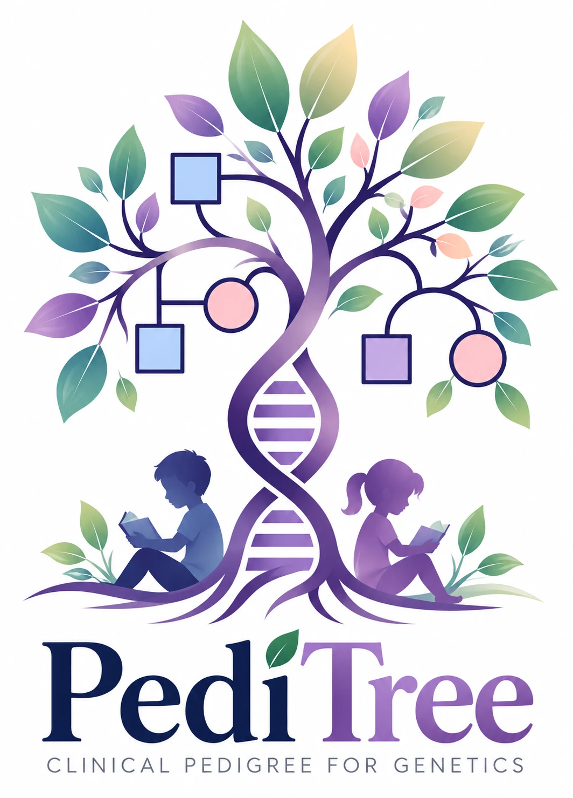

<p align="center">
  
</p>

<h1 align="center">PediTree</h1>

<p align="center">
  Genetik danışmanlık için klinik pedigri çizimi<br>
  <em>Clinical pedigree drawing for genetic counselling</em>
</p>

<p align="center">
  <a href="https://doi.org/10.5281/zenodo.23791764"></a>
</p>

---

## Türkçe

PediTree, genetik danışmanlıkta aile ağacını (pedigri) NSGC standart
gösterimine uygun çizmek için tarayıcıda çalışan bir araçtır. Klinisyen,
kimin kimin çocuğu, kardeşi, eşi ya da akrabası olduğunu yanlış okumamalı:
uygulama bu yüzden önce ilişkilerin doğruluğunu, sonra görünümü gözetir.

**Neler yapar**

- Proband, anne ve baba ile ya da hazır bir akraba evliliği şablonuyla başlar;
  kişiler çizimin üzerindeki menüyle eklenir.
- Etkilenmiş, taşıyıcı, ölmüş kişi; düşük, ölü doğum, gebelik sonlandırma,
  dış gebelik ve süren gebelik ayrı sembollerle gösterilir.
- Akraba evliliği çizimden hesaplanır: ortak ataları çizilmiş eşler çift
  çizgiyle ve derecesiyle gösterilir.
- İkizler, çocuksuzluk, genetik test sonuçları ve tanı yaşı çizilebilir.
- PNG, SVG, PDF (A4) ve PED olarak indirilir; yazdırılır; cihazın paylaşma
  menüsüyle gönderilir.

**Hasta bilgisi hiçbir sunucuya gönderilmez.** Çizim yalnızca açık sekmede
tutulur; sekme kapanınca silinir. Saklamak istediğiniz pedigriyi "Kaydet"
ile kendi bilgisayarınıza indirirsiniz.

PediTree bir çizim aracıdır, tıbbi cihaz değildir. Klinik kararlar çizime
değil, klinik değerlendirmeye dayanır.

## English

PediTree is a browser-based tool for drawing family pedigrees in standard
NSGC nomenclature for genetic counselling. The interface is in Turkish.
Structural correctness comes first: the graph model guarantees that every
child has at most one biological parent couple, that consanguinity is shown
only where shared ancestors are drawn, and that pregnancy outcomes keep their
distinct symbols.

**Patient data never leaves the browser.** There is no server and no
account; the drawing lives in the open tab and is gone when the tab closes.
Clinicians download what they want to keep.

PediTree is a drawing tool, not a medical device.

## Atıf / Citation

PediTree'yi bir yayında, sunumda ya da eğitim materyalinde kullandıysanız
lütfen atıf yapın:

> Kalenderoğlu MD. PediTree: clinical pedigree drawing for genetic counselling
> [Software]. Version 0.9.0. 2026. https://doi.org/10.5281/zenodo.23791764

Atıf bilgisi [`CITATION.cff`](CITATION.cff) dosyasındadır;
GitHub'da sağdaki **"Cite this repository"** bağlantısı hazır biçimler verir.

If you use PediTree in a publication, presentation or teaching material,
please cite it — see [`CITATION.cff`](CITATION.cff) or **"Cite this
repository"** on GitHub.

## Geliştirme / Development

Node.js 22 gerekir.

```bash
npm install
npm run dev      # http://localhost:5173
npm test         # birim testleri / unit tests
npm run build    # dist/ — durağan site / static site
```

Yerleşim motorunun ölçüm araçları: `npm run audit:layout-benchmark`,
`npm run audit:layout-fuzz -- --seed 1`. Mimari ve klinik kararlar
[`docs/`](docs/) klasöründedir.

Built with React, D3 and Zustand.

## Lisans / Licence

[Apache License 2.0](LICENSE) — © 2026 Muhammed Doğukan Kalenderoğlu.
"PediTree" adı ve logosu bu lisansın kapsamında değildir; ayrıntılar
[`NOTICE`](NOTICE) dosyasında. The PediTree name and logo are not covered by
the licence (see [`NOTICE`](NOTICE)).
