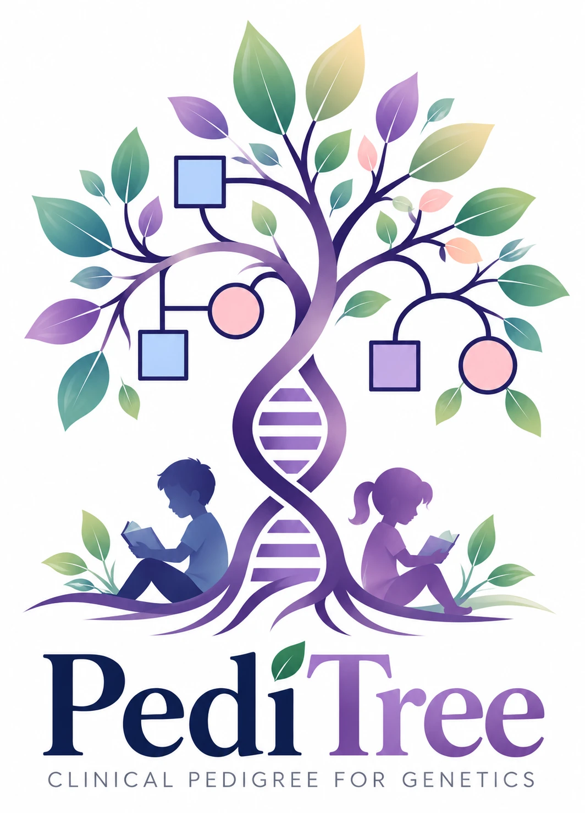
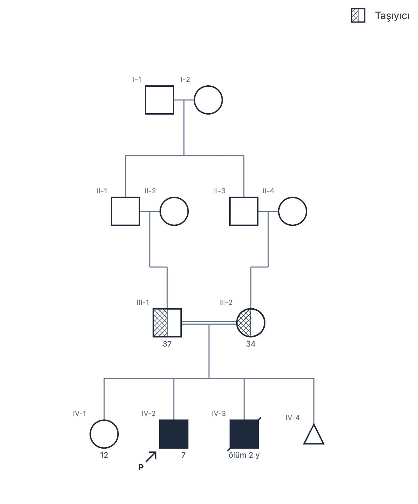

<p align="center">
  
</p>

<h1 align="center">PediTree</h1>

<p align="center">
  Clinical pedigree drawing for genetic counselling<br>
  <em>Genetik danışmanlık için klinik pedigri çizimi</em>
</p>

<p align="center">
  <a href="https://peditree.netlify.app"><strong>Open PediTree →</strong></a>
</p>

<p align="center">
  <a href="https://github.com/MDKalenderoglu/Peditree/actions/workflows/ci.yml"></a>
  <a href="https://doi.org/10.5281/zenodo.23791764"></a>
  <a href="LICENSE"></a>
</p>

<p align="center">
  
  <br><sub>A sample family (no patient data): first-cousin parents, both carriers, with two affected sons, one deceased.</sub>
</p>

---

**[Türkçe açıklama aşağıda ↓](#türkçe)**

## About

PediTree is a browser-based tool for drawing family pedigrees for genetic
counselling, in standard NSGC nomenclature (Bennett et al., 2022). It runs in
the browser on a computer, tablet or phone. There is nothing to install and no
account to create.

A clinician must never misread who is whose child, sibling, partner or blood
relative. For that reason PediTree puts structural correctness before looks.
Its graph model guarantees four things:

- every child has at most one biological parent couple;
- consanguinity is shown only where shared ancestors are drawn;
- pregnancy outcomes keep their distinct symbols;
- the layout may only place and route, never change what a symbol means.

**Patient data never leaves the browser.** There is no server. The drawing
lives only in the open tab and is gone when the tab closes. Clinicians
download what they want to keep.

PediTree is a drawing tool, not a medical device. Clinical decisions rest on
clinical assessment, not on the drawing.

## Features

- **Fast start:**
  - start from the proband, the parents and the grandparents;
  - or start from a ready-made consanguineous family. It covers first to
    third cousins, the once-removed pairs and double first cousins, with the
    inbreeding coefficient F and a preview.
- **Drawing by touch or mouse:** relatives are added from a ring menu on the
  drawing. Details go in a side panel.
- **NSGC 2022 notation:**
  - affected, carrier, presymptomatic and deceased;
  - proband and consultand;
  - miscarriage, stillbirth, termination, ectopic and ongoing pregnancy, each
    with its own symbol;
  - twins (identical, non-identical, unknown);
  - several people in one numbered symbol;
  - childlessness by choice or infertility;
  - separated partners;
  - sex assigned at birth;
  - records reviewed (\*);
  - genetic test results and age at diagnosis.
- **Relationships:**
  - adoption in and out, with brackets and a dashed line;
  - assisted reproduction with sperm or egg donors and surrogates;
  - same-sex partners (turned on in Settings);
  - partners from different generations.
- **Consanguinity from the structure:** partners with drawn shared ancestors
  get the double line, the degree and F automatically.
- **Automatic layout** that keeps birth order, avoids line crossings where it
  can, and moves as little as possible when you edit.
- **Turkish or English:** the interface and the drawing can each be set to
  either language.
- **Output:** PNG, SVG, one-page A4 PDF, print, and the device's share menu
  (optionally without the patient's name). PED files can be exported and
  imported. A project file stores the full pedigree for later.
- **Guided tour** on a sample family, so the patient's drawing is never
  touched.

## Feedback

- **Report a bug:** [bug report form](https://github.com/MDKalenderoglu/Peditree/issues/new?template=hata-bildirimi.yml)
- **Suggest something or share your experience:** [suggestion form](https://github.com/MDKalenderoglu/Peditree/issues/new?template=oneri.yml)
- **No GitHub account?** Email peditree.app@gmail.com

Please never include patient data. For security issues, see
[`SECURITY.md`](SECURITY.md).

## Citation

If you use PediTree in a publication, presentation or teaching material,
please cite it:

> Kalenderoğlu MD. PediTree: clinical pedigree drawing for genetic counselling
> [Software]. Version 0.9.0. 2026. https://doi.org/10.5281/zenodo.23791764

[`CITATION.cff`](CITATION.cff) holds the details. On GitHub, **"Cite this
repository"** on the right gives ready-made formats.

## Development

Requires Node.js 22.

```bash
npm install
npm run dev      # http://localhost:5173
npm test         # unit and screen tests (Vitest)
npm run lint
npm run build    # dist/ — a static site
```

Every change runs these checks on GitHub ([CI](.github/workflows/ci.yml)):

- lint;
- the full test suite;
- the generation check (`node verify-generations.mjs`);
- the build.

The layout engine has its own measuring tools:

- `npm run audit:layout-benchmark`
- `npm run audit:layout-fuzz -- --seed 1`

Design and clinical decisions are documented in [`docs/`](docs/).

The code is organised as follows:

| Folder | What it holds |
|---|---|
| `src/graph/` | the pedigree graph, its operations and validation |
| `src/layout/pcl/` | the layout engine: layered layout with pedigree constraints |
| `src/components/` | the screens (React) |
| `src/i18n/` | Turkish and English text |

Built with React, D3 and Zustand.

## Licence

[Apache License 2.0](LICENSE) — © 2026 Muhammed Doğukan Kalenderoğlu.
The PediTree name and logo are not covered by the licence (see
[`NOTICE`](NOTICE)).

---

## Türkçe

PediTree, genetik danışmanlıkta aile ağacını (pedigri) NSGC standart
gösterimine uygun çizmek için tarayıcıda çalışan bir araçtır. Bilgisayarda,
tablette ve telefonda çalışır; kurulum ya da hesap gerekmez.
**[PediTree'yi açın →](https://peditree.netlify.app)**

Klinisyen, kimin kimin çocuğu, kardeşi, eşi ya da akrabası olduğunu yanlış
okumamalıdır. Bu yüzden uygulama önce ilişkilerin doğruluğunu, sonra görünümü
gözetir.

**Neler yapar**

- **Başlangıç:**
  - proband, anne-baba ve büyükanne-büyükbabalarla başlanır;
  - ya da hazır bir akraba evliliği şablonuyla başlanır: 1.–3. derece
    kuzenler, bir kuşak farklı kuzenler ve çift kuzenler; F katsayısı ve
    önizleme ile.
- **Kişi ekleme:** kişiler çizimin üzerindeki halka menüyle eklenir; ayrıntılar
  yan panelde girilir.
- **NSGC 2022 işaretleri:**
  - etkilenmiş, taşıyıcı, presemptomatik ve ölmüş kişi;
  - proband ve danışan;
  - düşük, ölü doğum, gebelik sonlandırma, dış gebelik ve süren gebelik, her
    biri ayrı sembolle;
  - ikizler;
  - tek sembolde birden çok kişi;
  - çocuksuzluk;
  - ayrılmış eşler;
  - doğumda atanan cinsiyet;
  - kayıtlarla doğrulanmış tanı (\*);
  - genetik test sonuçları ve tanı yaşı.
- **İlişkiler:**
  - evlat edinme (köşeli parantez ve kesikli çizgiyle);
  - yardımla üreme (sperm / yumurta bağışçısı, taşıyıcı anne);
  - aynı cinsiyetten eşler (Ayarlar'dan açılır);
  - farklı kuşaklardan eşler.
- **Akraba evliliği çizimden hesaplanır:** ortak ataları çizilmiş eşler, çift
  çizgiyle, derecesiyle ve F katsayısıyla gösterilir.
- **Otomatik yerleşim:** doğum sırası korunur; düzenleme yapıldığında çizim
  olabildiğince az kıpırdar.
- **Dil:** arayüz ve çizim, birbirinden ayrı olarak Türkçe ya da İngilizce
  seçilebilir.
- **Çıktı:**
  - PNG, SVG, A4 PDF;
  - yazdırma;
  - cihazın paylaşma menüsü (istenirse hasta adı olmadan);
  - PED dosyası alma ve verme;
  - proje dosyası.
- **Örnek aile üzerinde rehberli tur:** hastanın çizimine dokunulmaz.

**Hasta bilgisi hiçbir sunucuya gönderilmez.** Çizim yalnızca açık sekmede
tutulur; sekme kapanınca silinir. Saklamak istediğiniz pedigriyi "Kaydet"
ile kendi cihazınıza indirirsiniz.

PediTree bir çizim aracıdır, tıbbi cihaz değildir. Klinik kararlar çizime
değil, klinik değerlendirmeye dayanır.

**Hata ve öneriler:**

- [Hata bildirimi formu](https://github.com/MDKalenderoglu/Peditree/issues/new?template=hata-bildirimi.yml)
- [Öneri formu](https://github.com/MDKalenderoglu/Peditree/issues/new?template=oneri.yml)
- GitHub hesabınız yoksa: peditree.app@gmail.com

Bildirimlere hasta bilgisi eklemeyin.

**Atıf:** PediTree'yi bir yayında, sunumda ya da eğitim materyalinde
kullandıysanız lütfen yukarıdaki atıf bilgisini kullanın
([`CITATION.cff`](CITATION.cff)).

---

<sub>Bennett RL, French KS, Resta RG, Austin J. Practice resource-focused
revision: Standardized pedigree nomenclature update centered on sex and gender
inclusivity: A practice resource of the National Society of Genetic
Counselors. *J Genet Couns.* 2022;31(6):1238–1248.
https://doi.org/10.1002/jgc4.1621</sub>
