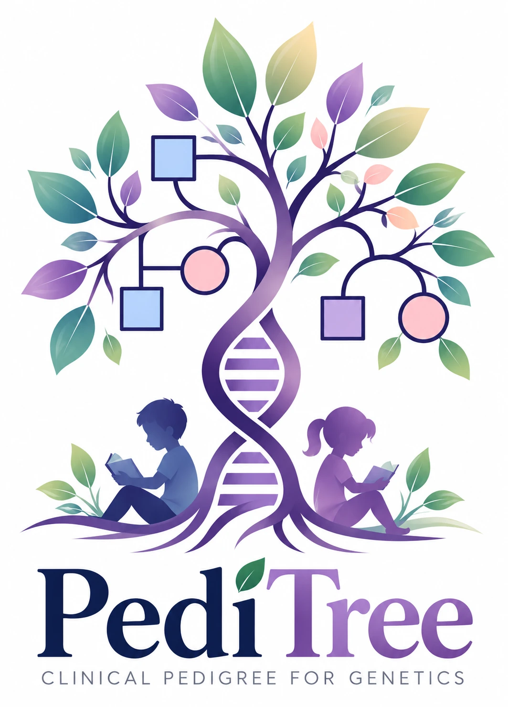

<p align="center">
  
</p>

<h1 align="center">PediTree</h1>

<p align="center">
  Clinical pedigree drawing for genetic counselling<br>
  <em>Genetik danışmanlık için klinik pedigri çizimi</em>
</p>

<p align="center">
  <a href="https://peditree.netlify.app"><strong>Open PediTree →</strong></a>
</p>

<p align="center">
  <a href="https://github.com/MDKalenderoglu/Peditree/actions/workflows/ci.yml"></a>
  <a href="https://doi.org/10.5281/zenodo.23791764"></a>
  <a href="LICENSE"></a>
</p>

<p align="center">
  
  <br><sub>A sample family drawn in PediTree (no patient data).</sub>
</p>

---

**[Türkçe ↓](#türkçe)**

## About

PediTree draws family pedigrees for genetic counselling in standard NSGC
notation (Bennett et al., 2022). It runs in the browser on a computer, tablet
or phone, with nothing to install and no account.

**Patient data never leaves the browser.** There is no server. The drawing
stays in the open tab; you download what you want to keep.

PediTree is a drawing tool, not a medical device.

## Features

- Start from the core family, or from a ready-made consanguineous family
- Add relatives from a ring menu on the drawing
- NSGC 2022 symbols: affected, carrier, deceased, pregnancies, twins, adoption, donors and more
- Consanguinity and the inbreeding coefficient (F) worked out from the drawing
- Automatic layout that keeps birth order and moves little as you edit
- Turkish or English, for the screens and the drawing separately
- PNG, PDF and SVG export; PED import and export; share without the patient's name

## How it was built

PediTree was designed and directed by Muhammed Doğukan Kalenderoğlu, a
paediatrician and paediatric genetics research fellow at Ankara University
Faculty of Medicine. The code was written with an AI coding assistant
(Anthropic's Claude) under the author's direction. Every clinical and design
decision is the author's, and every change is checked by more than 1,200
automated tests.
Decisions are dated in [`docs/`](docs/) and in the commit history.

## Feedback

[Report a bug](https://github.com/MDKalenderoglu/Peditree/issues/new?template=hata-bildirimi.yml) ·
[Suggest something](https://github.com/MDKalenderoglu/Peditree/issues/new?template=oneri.yml) ·
peditree.app@gmail.com. Please never include patient data. Security issues:
[`SECURITY.md`](SECURITY.md).

## Citation

> Kalenderoğlu MD. PediTree: clinical pedigree drawing for genetic counselling
> [Software]. Version 0.9.0. 2026. https://doi.org/10.5281/zenodo.23791764

Details in [`CITATION.cff`](CITATION.cff).

## Development

```bash
npm install
npm run dev     # http://localhost:5173
npm test
npm run build   # dist/, a static site
```

Requires Node.js 22. Design and clinical decisions: [`docs/`](docs/).

## Licence

[Apache License 2.0](LICENSE) © 2026 Muhammed Doğukan Kalenderoğlu. The
PediTree name and logo are not covered (see [`NOTICE`](NOTICE)).

---

## Türkçe

PediTree, genetik danışmanlıkta aile ağacını (pedigri) NSGC standart
gösterimiyle çizmek için bir araçtır. Bilgisayarda, tablette ve telefonda
tarayıcıda çalışır; kurulum ya da hesap gerekmez.
**[PediTree'yi açın →](https://peditree.netlify.app)**

**Hasta bilgisi tarayıcıdan çıkmaz.** Sunucu yoktur; çizim açık sekmede
durur, saklamak istediğinizi indirirsiniz. PediTree bir çizim aracıdır, tıbbi
cihaz değildir.

**Neler yapar:** temel aileyle ya da hazır bir akraba evliliği şablonuyla
başlama; çizim üzerindeki halka menüyle akraba ekleme; NSGC 2022 sembolleri;
çizimden hesaplanan akrabalık derecesi ve F katsayısı; doğum sırasını koruyan
otomatik yerleşim; Türkçe ya da İngilizce arayüz; PNG, PDF, SVG ve PED; hasta
adı olmadan paylaşma.

**Nasıl geliştirildi:** PediTree'yi Ankara Üniversitesi Tıp Fakültesi'nde
çocuk sağlığı ve hastalıkları uzmanı ve çocuk genetik hastalıkları araştırma
görevlisi Muhammed Doğukan Kalenderoğlu tasarladı ve yönetti. Kod, onun
yönlendirmesiyle bir yapay zekâ kodlama asistanı (Anthropic'in Claude'u) ile
yazıldı. Klinik ve tasarım kararlarının hepsi ona aittir; her değişiklik
1.200'ü aşkın otomatik testle denetlenir.

**Geri bildirim:** [hata bildirimi](https://github.com/MDKalenderoglu/Peditree/issues/new?template=hata-bildirimi.yml) ·
[öneri](https://github.com/MDKalenderoglu/Peditree/issues/new?template=oneri.yml) ·
peditree.app@gmail.com. Bildirimlere hasta bilgisi eklemeyin.

**Atıf:** yukarıdaki atıf bilgisini kullanın ([`CITATION.cff`](CITATION.cff)).

---

<sub>Bennett RL, French KS, Resta RG, Austin J. Standardized pedigree
nomenclature update centered on sex and gender inclusivity: A practice resource
of the National Society of Genetic Counselors. *J Genet Couns.*
2022;31(6):1238–1248. https://doi.org/10.1002/jgc4.1621</sub>
